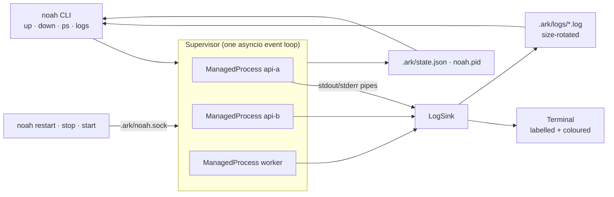

# ⛵ noah-ark

[](https://pypi.org/project/noah-ark/)
[](https://pypi.org/project/noah-ark/)
[](LICENSE)

**Run every service in your project from one YAML file, with one command.**
Live, labelled, colour-coded logs. Dependency-aware startup. Automatic restarts.
Clean shutdown of every process tree. No daemon, no containers, no Node runtime.

```text
$ noah up
ark    | » noah-ark 0.1.0 · 'demo' · 3 service(s) · Ctrl+C to stop
api-a  | » started (pid 41210)
api-b  | » waiting for api-a
worker | » waiting for api-a
api-a  | INFO:     Uvicorn running on http://127.0.0.1:8001 (Press CTRL+C to quit)
api-a  | » ready on 127.0.0.1:8001
api-b  | » started (pid 41215)
worker | » started (pid 41216)
worker | tick 1: processed 7 jobs
api-b  | INFO:     Uvicorn running on http://127.0.0.1:8002 (Press CTRL+C to quit)
api-b  | » ready on 127.0.0.1:8002
```

## Why

| | pm2 | Docker Compose | **noah-ark** |
|---|---|---|---|
| Runtime needed | Node.js + always-on daemon | Docker engine + images | Python 3.10+, one dependency (PyYAML) |
| Config | JS/JSON ecosystem file | `docker-compose.yml` | `ark.yaml` (compose-like, smaller) |
| Startup cost | Fast | Image build + container start | Plain process start |
| Wait for a port before starting dependents | No | Needs a healthcheck + condition | `ready: 8001` |
| Labelled multi-service live logs | Yes | Yes | Yes, plus merged history by timestamp |
| Kills the whole process tree (reloaders, workers) | Depends on settings | Yes (container) | Yes (process groups) |
| Isolation (filesystem, network, resources) | No | **Yes** | No |

noah-ark is **not a Docker replacement for production isolation**. It replaces the
"five terminals open, one per service" workflow and the pm2 setup for local
development, demos, and small single-machine deployments, with less overhead and
less to learn.

## Install

noah-ark is published on [PyPI](https://pypi.org/project/noah-ark/). The recommended
way to install a CLI tool is [pipx](https://pipx.pypa.io/), which keeps it in its own
environment and puts `noah` on your `PATH`:

```bash
pipx install noah-ark
# or with uv
uv tool install noah-ark
# or with plain pip (inside a virtualenv or with --user)
pip install noah-ark
```

Check it works:

```bash
noah --version
```

Upgrade later with `pipx upgrade noah-ark` (or `pip install -U noah-ark`).

Two commands are installed: `noah` and the alias `noah-ark`. Linux and macOS are
supported; on Windows use WSL.

To install the latest unreleased code instead:

```bash
pipx install git+https://github.com/andrewjonathan/noah-ark
```

## Quick start

```text
my-project/
├── ark.yaml
└── services/
    ├── api_a/main.py      # FastAPI app
    └── api_b/main.py      # FastAPI app
```

```bash
cd my-project
noah init        # scans ./services/* and writes ark.yaml
noah up          # start everything, stream logs, Ctrl+C stops it all
```

Try the bundled demo (it lives in the repository, not in the PyPI package):

```bash
git clone https://github.com/andrewjonathan/noah-ark
cd noah-ark/examples/demo
pip install -r requirements.txt
noah up
curl localhost:8002/orders/42      # api-b calls api-a; watch both logs
```

## Commands

| Command | What it does |
|---|---|
| `noah up [svc...]` | Start services (and their dependencies) in the foreground with live logs |
| `noah up -d` | Start in the background |
| `noah up --profile dev` | Also start services in the `dev` profile (repeatable) |
| `noah restart [svc...]` | Restart services in a running noah-ark, all of them by default |
| `noah stop svc...` | Stop some services; the rest keep running |
| `noah start svc...` | Start services that were stopped, finished or gave up |
| `noah logs [-f] [-n 100] [svc...]` | Show history merged by timestamp; `-f` follows live |
| `noah logs --grep ERROR [-i]` | Only lines matching a regex (works with `-f`) |
| `noah ps` | Status, pid, CPU, memory, restarts and uptime of every service |
| `noah down` | Gracefully stop a background run (`--force` to SIGKILL) |
| `noah init` | Generate `ark.yaml` from `./services/*` |
| `noah validate` | Check `ark.yaml` and print the start order |

Useful flags: `-t/--timestamps`, `--no-color`, `-f/--file path/to/ark.yaml`.
`NO_COLOR=1` and `FORCE_COLOR=1` are respected.

`restart`, `stop` and `start` work for both foreground and `-d` runs. Use them from
another terminal:

```text
$ noah ps
NAME    STATUS   PID    CPU   MEM  RESTARTS  UPTIME
api-a   running  41210  0.4%  47M  0         12m3s
api-b   running  41215  0.3%  47M  0         12m1s
worker  running  41216  0.0%  12M  0         12m1s

$ noah restart api-b
api-b: restarted
```

CPU and memory add up the service's whole process tree (reloaders, workers, children).
A requested restart skips the crash backoff and does not count toward `max_restarts`.

## ark.yaml reference

```yaml
version: 1
name: my-project            # optional, defaults to the folder name

env:                        # shared by all services; ${VAR} expands from your shell
  LOG_LEVEL: info

services:
  api-a:
    cwd: services/api_a                       # relative to ark.yaml
    cmd: uvicorn main:app --port 8001         # string or list
    venv: .venv                               # optional: use this service's virtualenv
    env: { DATABASE_URL: "${DATABASE_URL}" }
    env_file: .env                            # optional, relative to ark.yaml
    ready: 8001                               # wait for this port; see "Readiness" below
    restart: on-failure                       # no | on-failure (default) | always
    max_restarts: 10
    stop_timeout: 10                          # seconds between SIGTERM and SIGKILL
    shell: false                              # true runs cmd through /bin/sh -c

  api-b:
    cwd: services/api_b
    cmd: uvicorn main:app --port 8002
    depends_on: [api-a]                       # starts after api-a is ready
    ready: http://127.0.0.1:8002/health       # wait for GET /health to answer 2xx/3xx

  worker:
    cmd: python3 worker.py
    watch: "**/*.py"                          # restart when these files change

  admin:
    cmd: python3 admin.py
    profiles: [tools]                         # only with `noah up --profile tools`

  migrate: python3 migrate.py                 # shorthand: just a command
```

### Readiness

A dependent service starts once its dependencies are ready.

```yaml
ready: 8001                                   # the TCP port accepts connections
ready: http://127.0.0.1:8001/health           # GET returns 2xx or 3xx
ready:
  port: 8001
  host: 127.0.0.1                             # default
  http: /health                               # optional: also require an HTTP answer
  status: 200                                 # optional: require exactly this code
  timeout: 30                                 # seconds; after that, continue anyway
```

An open port does not always mean the app can serve requests (migrations, warm-up,
loading a model). Use `http` when that matters.

### File watching

```yaml
watch: "*.py"                                 # one pattern
watch: ["app/**/*.py", "templates/**"]        # several
watch:
  paths: ["**/*.py"]
  ignore: [build, "*.generated.py"]           # added to the defaults below
  interval: 1.0                               # seconds between scans
  debounce: 0.3                               # wait for a save to settle
```

Patterns are matched under the service's `cwd`. A pattern without `/` matches a file
name anywhere (`*.py`); one with `/` matches the relative path (`app/**/*.py`).
`.git`, `.venv`, `venv`, `node_modules`, `__pycache__`, `.ark` and editor swap files
are always ignored. Watching uses polling, so it needs no extra dependency and works
the same on every OS.

When a file changes, a running service restarts. A service that crashed and gave up,
or a one-shot task that finished, starts again, which makes `watch` handy for build
steps. A service you stopped with `noah stop` stays stopped until `noah start`.

`watch` works for any command. For uvicorn, use either `watch` or `--reload`, not both.

### Profiles

Services with `profiles` start only when one of their profiles is active
(`noah up --profile tools`), when named on the command line (`noah up admin`), or
when a selected service depends on them. Services without `profiles` always start.

Unknown keys are rejected with a helpful message, so typos fail loudly instead of
being silently ignored.

## Architecture



Design decisions:

- **One event loop, no daemon.** All services are read through non-blocking pipes in a
  single asyncio loop, so overhead stays roughly constant as you add services. The only
  thread work is the `watch` directory scan, so a large tree never stalls log output.
- **Each service gets its own process group** (`start_new_session`). Ctrl+C reaches only
  noah-ark, which stops services in reverse dependency order; stopping a service signals
  its whole tree (uvicorn reloaders, gunicorn workers, shell children), and leftover
  children are reaped when a service exits, so no orphans hold your ports.
- **Dependency waves.** Services are grouped by a topological sort. A dependent starts
  only once its dependencies' `ready` port accepts connections.
- **Exponential backoff** on crashes (0.5s → 30s cap), reset after 30s of healthy uptime.
- **Files are the IPC.** A background run writes per-service logs and an atomically
  replaced `state.json`; `noah logs` and `noah ps` just read them. Nothing to keep alive.
  The one exception is `restart`/`stop`/`start`, which send a JSON line to the running
  supervisor over a Unix socket (`.ark/noah.sock`, mode 0600).
- **`PYTHONUNBUFFERED=1` is set by default**, so Python output appears instantly instead
  of in 4 KB chunks when piped.

Note: uvicorn writes its normal `INFO` logs to **stderr**, so noah-ark does not colour
stderr as an error.

## Project layout

```text
src/noah_ark/
├── cli.py         # argparse commands
├── config.py      # ark.yaml loading, validation, dependency ordering
├── supervisor.py  # runs a project, signals, ordered shutdown, per-service control
├── process.py     # one supervised service: spawn, pump logs, ready check, restart
├── control.py     # control socket server + client for restart/stop/start
├── watch.py       # polling file watcher, glob patterns
├── procstats.py   # CPU / memory per process group for `noah ps`
├── logs.py        # formatter, console sink, rotating files, tail
└── state.py       # pid file + state.json
```

## Development

```bash
git clone https://github.com/andrewjonathan/noah-ark && cd noah-ark
python -m venv .venv && . .venv/bin/activate
pip install -e ".[dev]"
ruff check . && pytest -q
```

## Roadmap

- [x] `noah restart|stop|start <svc>` via a control socket (`.ark/noah.sock`)
- [x] File watching (`watch: ["**/*.py"]`) for any service, not only uvicorn `--reload`
- [x] HTTP readiness checks (`ready: {http: /health}`)
- [x] Per-service CPU / memory in `noah ps`
- [x] Log filtering: `noah logs --grep ERROR`
- [x] `noah up --profile dev` (service groups)
- [ ] Windows support (Job Objects instead of process groups)
- [x] Distribution: PyPI (`pipx install noah-ark`)
- [ ] Distribution: `.deb` packages on GitHub Releases built with nfpm, then a
      Launchpad PPA for `apt install noah-ark`

## Releasing (maintainers)

> **GitHub Actions is currently paused.** `ci.yml` and `release.yml` only run when
> started by hand from the Actions tab; pushes, pull requests and tags do not trigger
> them. Release from your machine as described below. To turn automation back on, restore
> the `on:` triggers noted at the top of each workflow file.

Release with [`scripts/release.sh`](scripts/release.sh). It bumps the version, runs
`ruff` and `pytest`, builds and checks the package with `twine`, uploads it to PyPI,
then commits, tags and pushes. It stops at the first failure and asks before the upload
and the push.

```bash
pip install -e ".[dev]" twine            # one-time: tools the script needs
export PYPI_TOKEN=pypi-...               # token scoped to the noah-ark project
                                         # (https://pypi.org/manage/account/token/)

scripts/release.sh patch --dry-run       # check everything, upload nothing
scripts/release.sh patch                 # 0.1.0 -> 0.1.1 (also: minor, major, or 0.2.0)
```

Run it from a clean `main` branch. Without `PYPI_TOKEN`, it falls back to `~/.pypirc`.
Add `--yes` to skip the confirmation prompts. Users then get the new version with
`pipx upgrade noah-ark`.

## License

MIT
