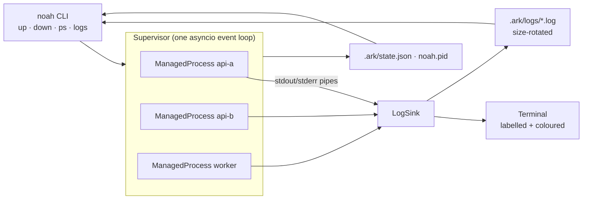

# ⛵ noah-ark

**Run every service in your project from one YAML file, with one command.**
Live, labelled, colour-coded logs. Dependency-aware startup. Automatic restarts.
Clean shutdown of every process tree. No daemon, no containers, no Node runtime.

```text
$ noah up
ark    | » noah-ark 0.1.0 · 'demo' · 3 service(s) · Ctrl+C to stop
api-a  | » started (pid 41210)
api-b  | » waiting for api-a
worker | » waiting for api-a
api-a  | INFO:     Uvicorn running on http://127.0.0.1:8001 (Press CTRL+C to quit)
api-a  | » ready on 127.0.0.1:8001
api-b  | » started (pid 41215)
worker | » started (pid 41216)
worker | tick 1: processed 7 jobs
api-b  | INFO:     Uvicorn running on http://127.0.0.1:8002 (Press CTRL+C to quit)
api-b  | » ready on 127.0.0.1:8002
```

## Why

| | pm2 | Docker Compose | **noah-ark** |
|---|---|---|---|
| Runtime needed | Node.js + always-on daemon | Docker engine + images | Python 3.10+, one dependency (PyYAML) |
| Config | JS/JSON ecosystem file | `docker-compose.yml` | `ark.yaml` (compose-like, smaller) |
| Startup cost | Fast | Image build + container start | Plain process start |
| Wait for a port before starting dependents | No | Needs a healthcheck + condition | `ready: 8001` |
| Labelled multi-service live logs | Yes | Yes | Yes, plus merged history by timestamp |
| Kills the whole process tree (reloaders, workers) | Depends on settings | Yes (container) | Yes (process groups) |
| Isolation (filesystem, network, resources) | No | **Yes** | No |

noah-ark is **not a Docker replacement for production isolation**. It replaces the
"five terminals open, one per service" workflow and the pm2 setup for local
development, demos, and small single-machine deployments, with less overhead and
less to learn.

## Install

```bash
pip install noah-ark        # once published
# or, from source:
git clone https://github.com/YOUR_USERNAME/noah-ark && cd noah-ark
pip install -e .
```

Two commands are installed: `noah` and the alias `noah-ark`. Linux and macOS are
supported; on Windows use WSL.

## Quick start

```text
my-project/
├── ark.yaml
└── services/
    ├── api_a/main.py      # FastAPI app
    └── api_b/main.py      # FastAPI app
```

```bash
cd my-project
noah init        # scans ./services/* and writes ark.yaml
noah up          # start everything, stream logs, Ctrl+C stops it all
```

Try the bundled demo:

```bash
cd examples/demo
pip install -r requirements.txt
noah up
curl localhost:8002/orders/42      # api-b calls api-a; watch both logs
```

## Commands

| Command | What it does |
|---|---|
| `noah up [svc...]` | Start services (and their dependencies) in the foreground with live logs |
| `noah up -d` | Start in the background |
| `noah logs [-f] [-n 100] [svc...]` | Show history merged by timestamp; `-f` follows live |
| `noah ps` | Status, pid, restarts and uptime of every service |
| `noah down` | Gracefully stop a background run (`--force` to SIGKILL) |
| `noah init` | Generate `ark.yaml` from `./services/*` |
| `noah validate` | Check `ark.yaml` and print the start order |

Useful flags: `-t/--timestamps`, `--no-color`, `-f/--file path/to/ark.yaml`.
`NO_COLOR=1` and `FORCE_COLOR=1` are respected.

## ark.yaml reference

```yaml
version: 1
name: my-project            # optional, defaults to the folder name

env:                        # shared by all services; ${VAR} expands from your shell
  LOG_LEVEL: info

services:
  api-a:
    cwd: services/api_a                       # relative to ark.yaml
    cmd: uvicorn main:app --port 8001         # string or list
    venv: .venv                               # optional: use this service's virtualenv
    env: { DATABASE_URL: "${DATABASE_URL}" }
    env_file: .env                            # optional, relative to ark.yaml
    ready: 8001                               # or {port: 8001, host: 127.0.0.1, timeout: 30}
    restart: on-failure                       # no | on-failure (default) | always
    max_restarts: 10
    stop_timeout: 10                          # seconds between SIGTERM and SIGKILL
    shell: false                              # true runs cmd through /bin/sh -c

  api-b:
    cwd: services/api_b
    cmd: uvicorn main:app --port 8002
    depends_on: [api-a]                       # starts after api-a is ready

  worker: python3 worker.py                   # shorthand: just a command
```

Unknown keys are rejected with a helpful message, so typos fail loudly instead of
being silently ignored.

## Architecture



Design decisions:

- **One event loop, no threads, no daemon.** All services are read through non-blocking
  pipes in a single asyncio loop, so overhead stays roughly constant as you add services.
- **Each service gets its own process group** (`start_new_session`). Ctrl+C reaches only
  noah-ark, which stops services in reverse dependency order; stopping a service signals
  its whole tree (uvicorn reloaders, gunicorn workers, shell children), and leftover
  children are reaped when a service exits, so no orphans hold your ports.
- **Dependency waves.** Services are grouped by a topological sort. A dependent starts
  only once its dependencies' `ready` port accepts connections.
- **Exponential backoff** on crashes (0.5s → 30s cap), reset after 30s of healthy uptime.
- **Files are the IPC.** A background run writes per-service logs and an atomically
  replaced `state.json`; `noah logs` and `noah ps` just read them. Nothing to keep alive.
- **`PYTHONUNBUFFERED=1` is set by default**, so Python output appears instantly instead
  of in 4 KB chunks when piped.

Note: uvicorn writes its normal `INFO` logs to **stderr**, so noah-ark does not colour
stderr as an error.

## Project layout

```text
src/noah_ark/
├── cli.py         # argparse commands
├── config.py      # ark.yaml loading, validation, dependency ordering
├── supervisor.py  # runs a project, signals, ordered shutdown
├── process.py     # one supervised service: spawn, pump logs, ready check, restart
├── logs.py        # formatter, console sink, rotating files, tail
└── state.py       # pid file + state.json
```

## Development

```bash
python -m venv .venv && . .venv/bin/activate
pip install -e ".[dev]"
ruff check . && pytest -q
```

## Publishing

**PyPI:** check that the name `noah-ark` is free on pypi.org, add a Trusted Publisher
for this repo (workflow `release.yml`, environment `pypi`), then:

```bash
git tag v0.1.0 && git push --tags
```

Users then install with `pip install noah-ark` or, better for CLI tools, `pipx install noah-ark`.

**apt:** Debian packaging comes after PyPI. The simplest route is building a `.deb`
in CI (for example with nfpm, depending on `python3` and `python3-yaml`) and attaching it
to GitHub Releases; a Launchpad PPA enables `sudo apt install noah-ark`.

## License

MIT
